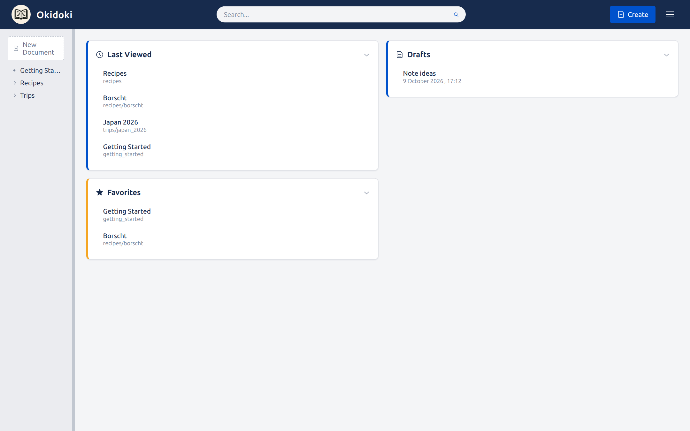
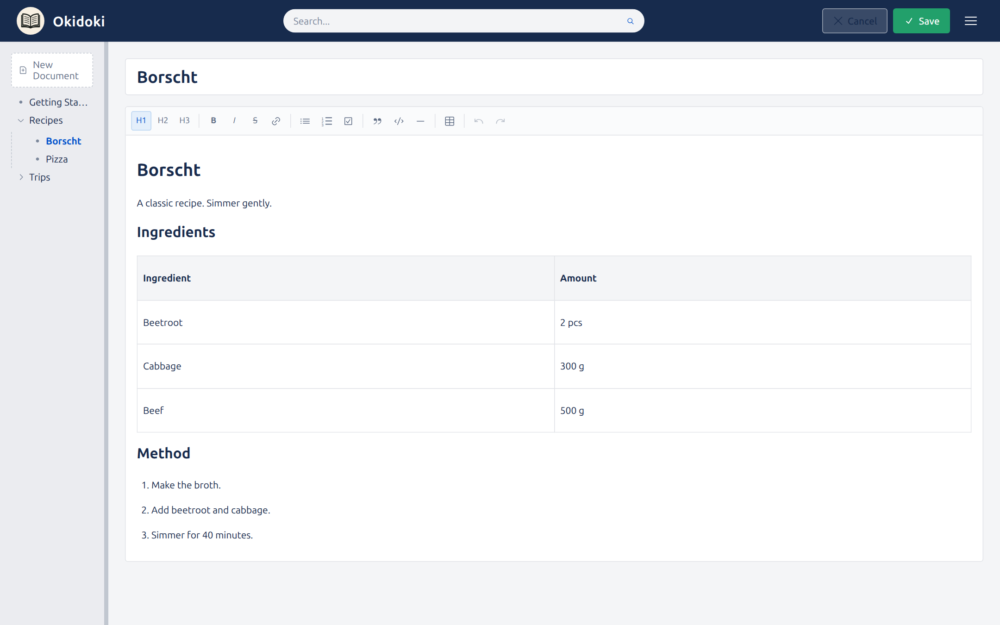
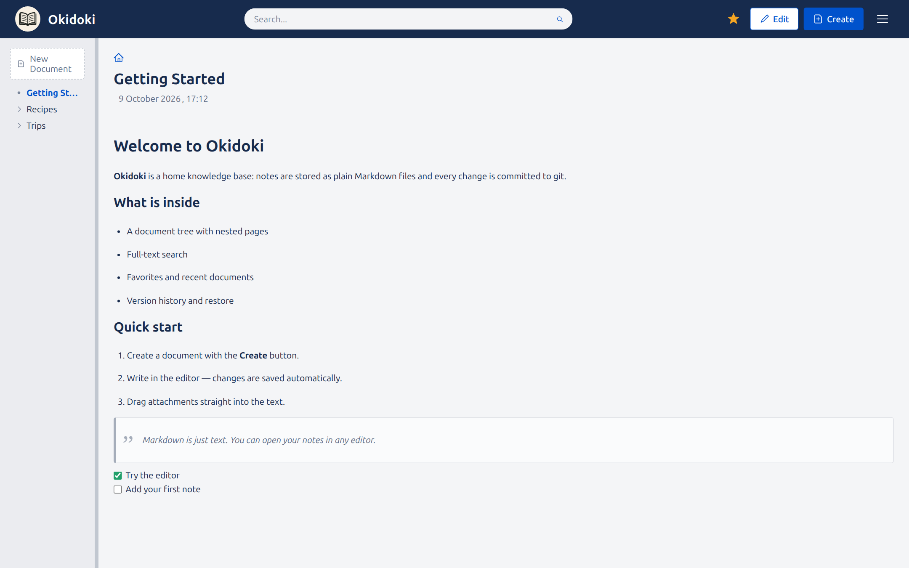
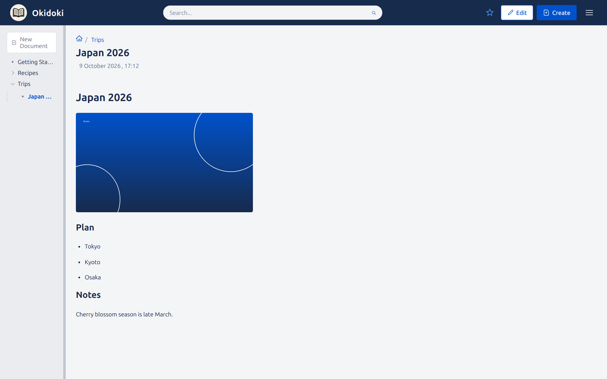
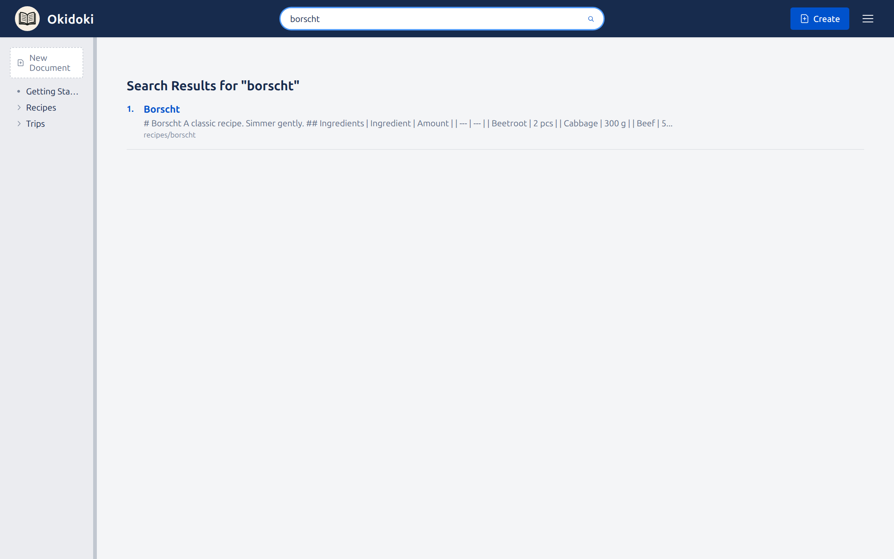
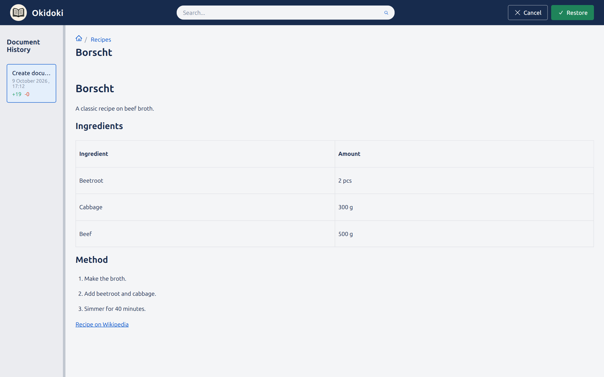
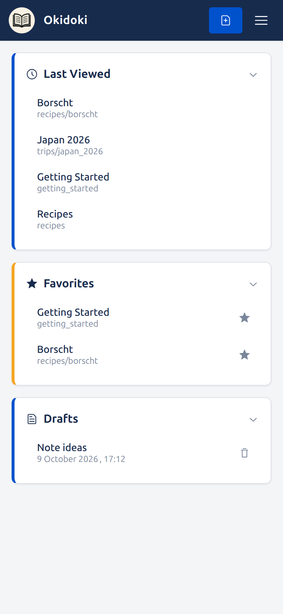

# Okidoki

**[Русская версия →](README.md)**

**A home knowledge base that fits entirely in one folder on your disk.**
Markdown notes in a tree, full-text search, attachments and version history — all
running on your own server, with no cloud and no subscription.



## What it is

Okidoki is a personal wiki. You write notes in a comfortable editor, and on disk
they stay **plain Markdown files** in the `data/` folder. There is no proprietary
database: notes can be opened in any text editor, found with `grep`, synced with a
script, or kept in your own git repository.

The server is a single Go binary that serves the web UI and stores the data. It
starts with a single Docker command.

## Why you might want it

- **Your data stays yours.** Everything is files next to the app. Delete the app —
  the notes remain.
- **History out of the box.** Every change is committed to git: you can see what
  changed and when, and view or restore any version of a document.
- **Nothing to administer.** No external services, accounts or payments.
- **Runs at home.** A laptop, a mini-PC or a Raspberry Pi is enough.

## Features

- WYSIWYG editor (headings, lists, checklists, tables, syntax-highlighted code,
  quotes) — yet the result always stays clean Markdown/GFM.
- Document tree with nested pages and breadcrumbs.
- Full-text search across titles and content (stemming for RU and EN).
- Favorites and a list of recently viewed documents.
- Version history and restore of a previous state.
- Attachments: images and files are dragged right into the text; images resize
  from a corner (keeping the ratio) or an edge.

## Who it is for

- You keep personal notes, recipes, documentation or plans and want everything at
  home.
- You can run `docker compose up`.
- You would rather not depend on a cloud service and its subscription.

**Not a fit if** you need collaboration with roles and access control, or direct
internet exposure: there is no built-in authentication, so the app assumes a
trusted local network (see below).

## What it looks like

### Editing

An editor with a formatting toolbar; changes are auto-saved, and the "Save" button
commits a version to the history.



### Reading

Documents open in a read mode with formatting, tables, quotes, checklists and
attachments.





### Search

Full-text search across all documents.



### Version history

A list of a document's changes, with the ability to open and restore any version.



### On a phone

The interface adapts to mobile screens.

<p align="left">
  
</p>

## Quick start

### Docker (recommended)

```sh
docker compose up -d --build
```

The app is available at `http://localhost:8080`. The `./data` folder is mounted
into the container and holds the whole knowledge base.

Update to a new version:

```sh
git pull
docker compose up -d --build
```

Stop:

```sh
docker compose down
```

### Without Docker

```sh
make build-be                # builds the frontend and binaries into bin/
./bin/okidoki-linux-amd64    # data/ is created next to the current directory
```

### Environment variables

| Variable | Default | Purpose |
| --- | --- | --- |
| `OKIDOKI_LANG` | `ru` | UI language (`ru`/`en`) and search stemming languages (`ru` → english+russian, `en` → english). |
| `OKIDOKI_MAX_UPLOAD_MB` | `2048` | Max size of a single uploaded file, in MiB. |

### Network access and security

By default the port is published as `8080:8080`, so it listens on every host
interface. There is no built-in authentication, therefore:

- on a home network this is usually fine;
- if the server is reachable from the internet or an untrusted network, put
  Okidoki behind a reverse proxy with authentication, or restrict access via
  Tailscale/VPN. You can also publish the port on localhost only — replace
  `"8080:8080"` with `"127.0.0.1:8080:8080"` in `docker-compose.yaml`.

## Data and backups

The whole knowledge base lives in `data/`:

- `data/docs/` — documents and attachments (with a git repository holding history);
- `data/drafts/` — drafts;
- `data/metadata` — favorites and recent documents.

Automatic backups are not set up yet — make copies manually.

Backup:

```sh
cp -a data data.bak-$(date +%F)
```

Restore:

```sh
docker compose down
rm -rf data && mv data.bak-2026-01-01 data
docker compose up -d
```

A single document can be rolled back through the built-in version history. The
history is also visible from git: `git -C data log -- docs`.

## Tech stack

- **Backend:** Go, HTTP API on `gorilla/mux`, file-based storage + `go-git`.
- **Frontend:** React 19, editor built on TipTap v3 limited to Markdown/GFM.
- **Distribution:** a single binary with the static bundle embedded; the Docker
  image is built from source (Node builds the SPA, Go embeds it).
