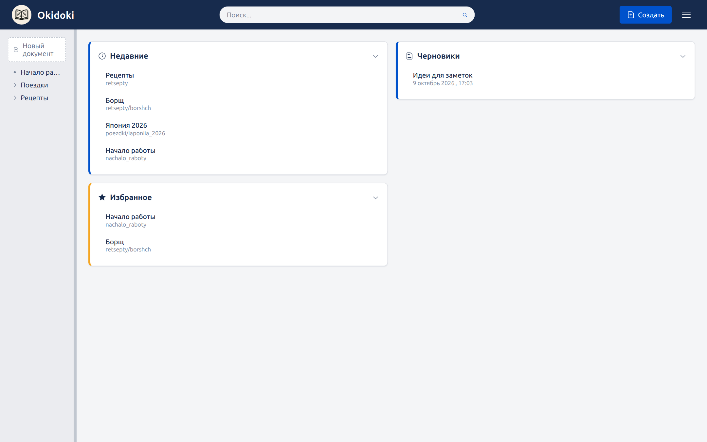
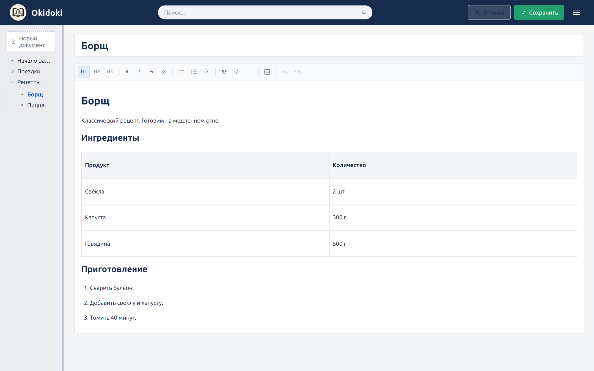
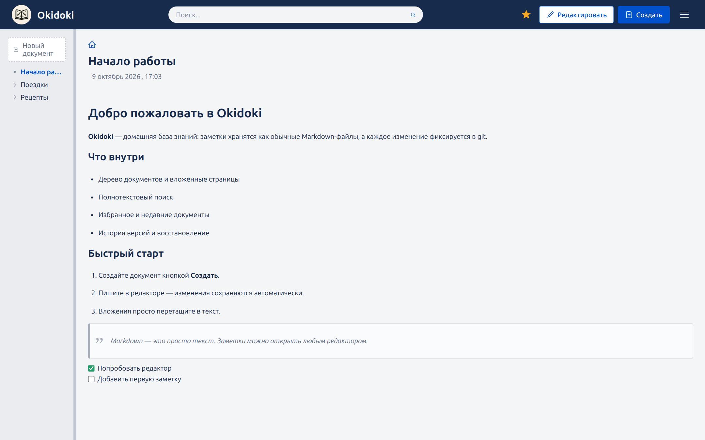
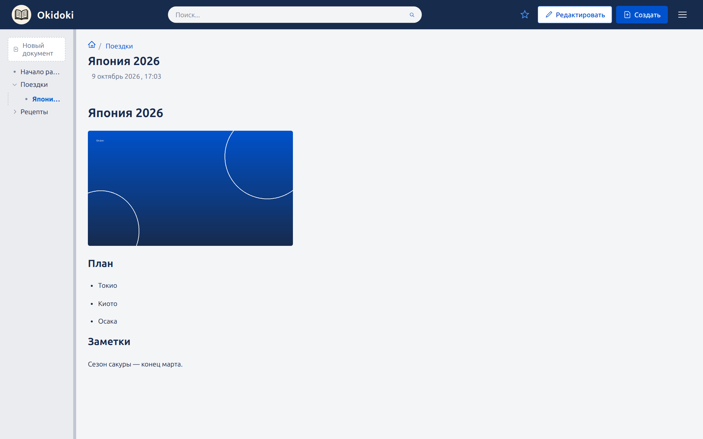
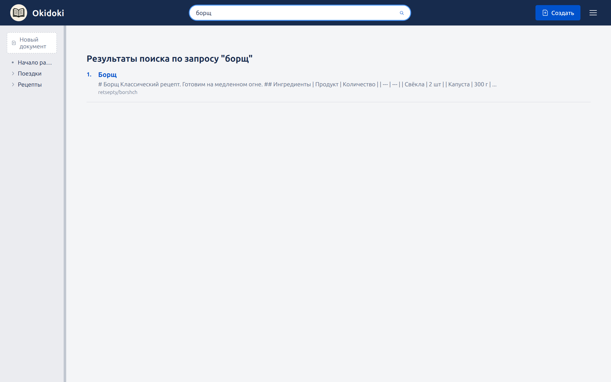
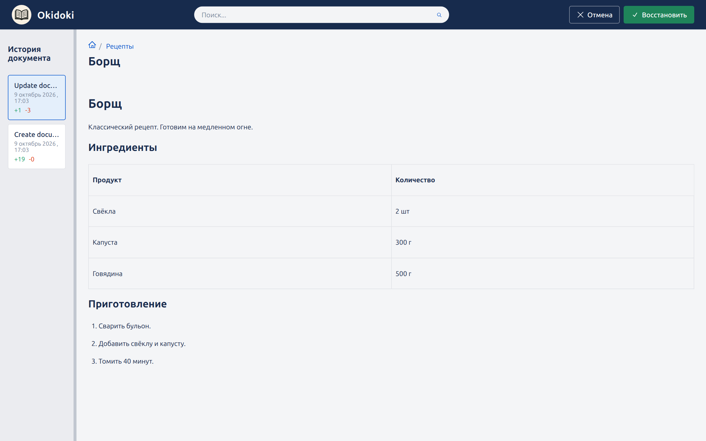
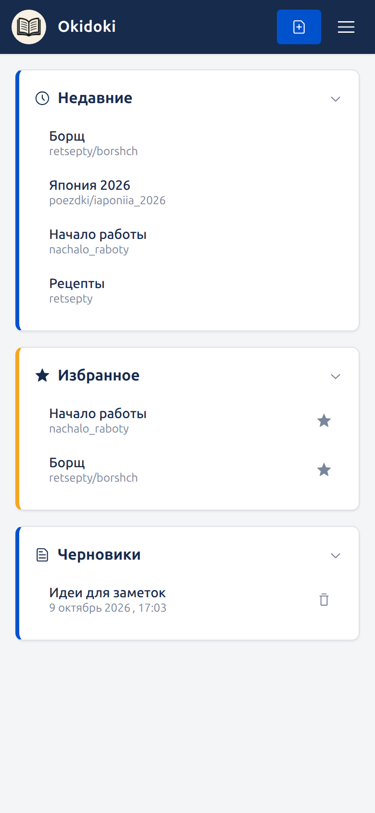

# Okidoki

**[English version →](README.en.md)**

**Домашняя self-hosted база знаний, которая хранит всё в обычных Markdown-файлах и не требует БД.**
Markdown-заметки в виде дерева, полнотекстовый поиск, вложения и история версий.



## Что это

Okidoki — это личная вики. Вы пишете заметки в удобном редакторе, а на диске они
остаются **обычными Markdown-файлами** в папке `data/`. Никакой проприетарной базы
данных: заметки можно открыть любым текстовым редактором, найти через `grep`,
синхронизировать скриптом или положить в свой git.

Сервер — один Go-бинарник, который раздаёт веб-интерфейс и хранит данные.
Запускается в Docker одной командой.

По духу это лёгкая замена Confluence: та же древовидная вики, но без тяжести и
лишних функций — заточено под личное использование.

## Зачем это нужно

- **Данные принадлежат вам.** Всё лежит файлами рядом с приложением. Удалили
  приложение — заметки остались.
- **История из коробки.** Каждое изменение фиксируется в git: видно, что и когда
  менялось, любую версию документа можно посмотреть и восстановить.
- **Ничего не надо администрировать.** Нет внешних сервисов, аккаунтов, платежей.
- **Работает дома.** Достаточно ноутбука, мини-ПК или Raspberry Pi.

## Возможности

- WYSIWYG-редактор (заголовки, списки, чек-листы, таблицы, код с подсветкой,
  цитаты) — но результат всегда остаётся чистым Markdown/GFM.
- Дерево документов с вложенными страницами и хлебными крошками.
- Полнотекстовый поиск по заголовкам и содержимому (морфология для RU и EN).
- Избранное и список недавно открытых документов.
- История версий и восстановление предыдущего состояния.
- Вложения: картинки и файлы перетаскиваются прямо в текст; картинки
  масштабируются за уголок или за край.

## Кому подойдёт

- Ведёте личные заметки, рецепты, документацию, планы и хотите всё у себя.
- Умеете запустить `docker compose up`.
- Не хотите зависеть от облачного сервиса и его подписки.

**Не подойдёт, если** нужна совместная работа с ролями и правами доступа или доступ
из интернета «как есть»: встроенной аутентификации нет, приложение рассчитано на
доверенную локальную сеть (см. ниже).

## Как это выглядит

### Редактирование

Редактор с панелью форматирования; изменения автосохраняются, кнопка «Сохранить»
фиксирует версию в истории.



### Чтение

Документы открываются в режиме чтения с форматированием, таблицами, цитатами,
чек-листами и вложениями.





### Поиск

Полнотекстовый поиск по всем документам.



### История версий

Список изменений документа с возможностью открыть и восстановить любую версию.



### На телефоне

Интерфейс адаптируется под мобильный экран.

<p align="left">
  
</p>

## Быстрый старт

### Docker (рекомендуется)

```sh
docker compose up -d --build
```

Сервис откроется на `http://localhost:8080`. Папка `./data` монтируется в
контейнер и хранит всю базу.

Обновление до новой версии:

```sh
git pull
docker compose up -d --build
```

Остановка:

```sh
docker compose down
```

### Без Docker

```sh
make build-be                # соберёт frontend и бинарники в bin/
./bin/okidoki-linux-amd64    # data/ создастся рядом с текущим каталогом
```

### Переменные окружения

| Переменная | По умолчанию | Назначение |
| --- | --- | --- |
| `OKIDOKI_LANG` | `ru` | Язык интерфейса (`ru`/`en`) и языки морфологии поиска (`ru` → english+russian, `en` → english). |
| `OKIDOKI_MAX_UPLOAD_MB` | `2048` | Потолок размера одного загружаемого файла, МиБ. |

### Доступ из сети и безопасность

По умолчанию порт публикуется как `8080:8080` — слушают все интерфейсы хоста.
Встроенной аутентификации нет, поэтому:

- для домашней сети это обычно нормально;
- если сервер доступен из интернета или недоверенной сети, поставьте Okidoki за
  reverse-proxy с авторизацией либо ограничьте доступ через Tailscale/VPN. Можно
  также публиковать порт только на localhost — замените в `docker-compose.yaml`
  `"8080:8080"` на `"127.0.0.1:8080:8080"`.

## Данные и резервные копии

Вся база лежит в `data/`:

- `data/docs/` — документы и вложения (внутри — git-репозиторий с историей);
- `data/drafts/` — черновики;
- `data/metadata` — избранное и недавние.

Автоматический бэкап пока не настроен — сохранность делается вручную.

Резервная копия:

```sh
cp -a data data.bak-$(date +%F)
```

Восстановление:

```sh
docker compose down
rm -rf data && mv data.bak-2026-01-01 data
docker compose up -d
```

Отдельный документ можно откатить через встроенную историю версий. Историю также
видно из git: `git -C data log -- docs`.

## Технологии

- **Бэкенд:** Go, HTTP API на `gorilla/mux`, хранение на файлах + `go-git`.
- **Фронтенд:** React 19, редактор на TipTap v3 с ограничением Markdown/GFM.
- **Распространение:** один бинарник со встроенной статикой; сборка Docker-образа
  из исходников (Node собирает SPA, Go встраивает её).
